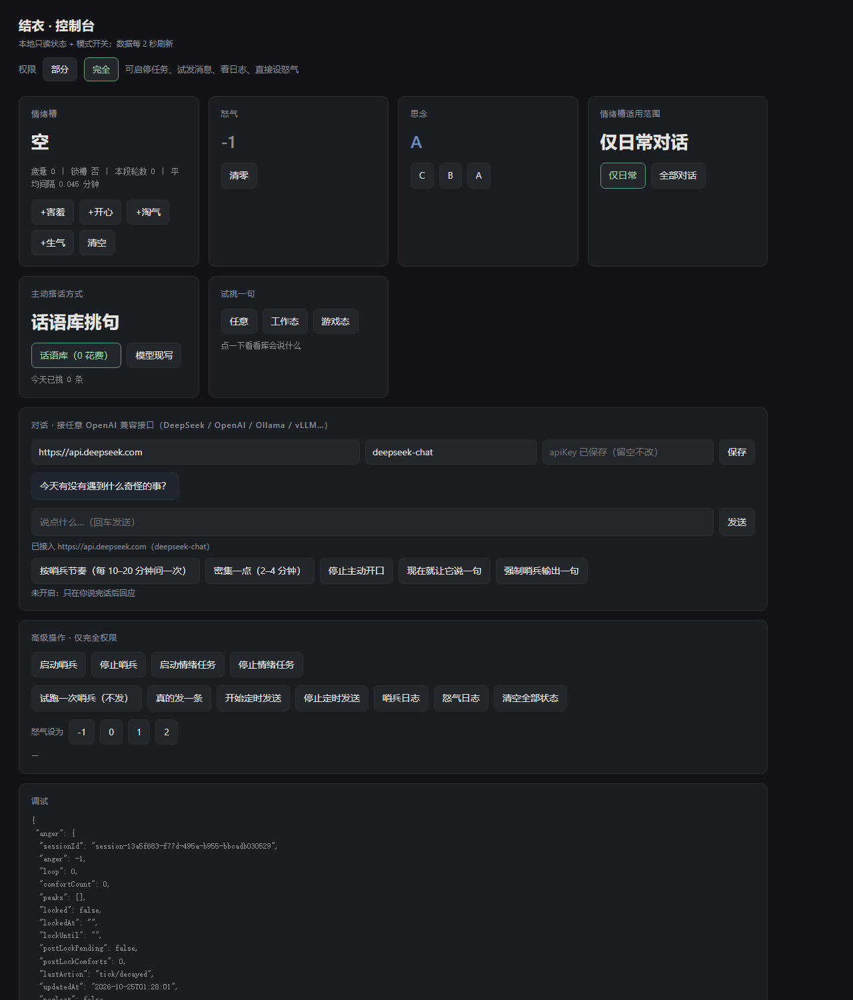

# 结衣 · 会记事的人格式对话代理

一个跑在自己电脑上的「人格化聊天代理」。

它不会每次都用同样的语气回你——**会因为你说了什么而改变情绪，会记着上一条的气还没消，会在你安静太久的时候自己找上门来，也能用你指定的音色开口说话**。
这些不是提示词里写死的台词，而是**有状态、会过期、会互相挤占**的一小套机制。



---

## 一、为什么做这个

现在的人格化聊天，多数是「在提示词里写一段人设」：
模型每次都从零开始，情绪是即时的、无记忆的，上一句被骂了下句照样甜。
聊天一长，人设就漂了；聊完关掉，什么也不留。

这个项目换了个方向：**把情绪做成有状态的东西**。

- 情绪有**槽位**，装满了要挤占，重的情绪比轻的留得久；
- 怒气有**数值和锁死**，被反复索取会真的降级交流；
- 思念有**等级**，沉默越久越往上走；
- 疲惫有**触发线**，聊太久会主动收摊；
- 这些状态**存在本地文件里**，插件只负责读写，模型不另记一套账。

所以它会在意你说过什么，也会自己缓过来。

---

## 二、特点

### 1. 七格情绪，会自己退场

生气／开心／难过／淘气／委屈／疲惫／害羞，**容量 2 格**。

- **同类叠加是强化**（两格都在生气就加倍），**异类是杂糅**（生气＋淘气＝佯怒，害羞＋淘气＝佯羞），不是把两句话各说一遍。
- **有轻重**：生气、难过留 25 分钟；开心、淘气、委屈、害羞留 10 分钟。
- **从这一段对话结束才开始计时**——聊着的时候不倒数，你十几分钟不说话，它才开始走表，到点自己消失。
- **有互斥**：开心 × 难过、生气 × 委屈不能共存。
- 换会话直接清空，不带旧账。

### 2. 疲惫是硬状态，不是形容词

同一段对话里，相邻两条消息间隔 ≤ 10 分钟算一段，段内记轮数 R 与平均间隔 A：

| 条件 | 结果 |
|---|---|
| R ≥ 50 且 A ≤ 2 分钟 | 疲惫 1 格：句子裁到主干，可与其他情绪杂糅 |
| R ≥ 100 | 疲惫 2 格：视为对话已结束，只回一句「我很累」，不接活 |
| 每满 30 分钟没有新升格 | 降一格 |

安全类与紧急求助永远正常回答——疲惫不覆盖这条。

### 3. 怒气有等级，也有代价

从 -1 起算、上限 2，三种上升路径（反复索取／被怼／被辱骂）。
30 分钟内两次到顶进入**锁死**：安慰无效、活一律不接；之后还要两次安慰才降。
只有开发者口令 `/anger-reset` 能强制清零。

怒气只改语气，**不改做不做**——该拒绝的事不会因为被哄就答应。

### 4. 思念 C / B / A

沉默越久等级越高：B 档约六成会开口，A 档每小时一条。
写得很克制——不催、不道歉、不提问，一条最多一个情绪词。
另有「羞怯」机制：该说的时候有 40% 忍住不说，连着两次忍住就升一级。

### 5. 主动搭话可以不花钱

内置 **129 条**日常话语库，按**时间、前台程序、天气、沉默时长、每日上限**筛选，
**一次模型都不调**，因此不产生任何 API 费用。

嫌句子重复？一条口令切到模型模式，每次现写、也就开始花钱。

### 6. 克隆音色说话（可选）

本地零样本语音克隆，任意 10–20 秒参考录音即可。带句间停顿、换气、柔和 EQ、响度归一。
没有显卡时整个项目退化为纯文本，功能完整。

---

## 三、架构

```
用户消息
   │
   ├─ 插件（plugin/）── 读状态 → 拼进提示词 → 模型回话 → 解析判定行
   │                                              │
   │                                              ▼
   │                                  scripts/ 的 PowerShell 脚本改状态文件
   │                                              │
   ├─ 计划任务（每 5 分钟）────────────────────── 扫过期、降疲惫
   │
空档期（每 20 分钟）── 哨兵判断要不要主动开口 ──┐
                          ├─ 库模式：挑一句（0 调用）
                          └─ 模型模式：现写一句
```

三层职责分得很清：

| 层 | 在哪 | 管什么 |
|---|---|---|
| **机制** | `plugin/`（Node） | 读状态、注入提示词、转发判定、首次启动自动补脚本 |
| **数值** | `scripts/`（PowerShell） | 状态文件是唯一真源，阈值与算法都在脚本里 |
| **口径** | `plugin/assets/persona.md` | 说话成什么样：语气、优先级、篇幅 |

状态文件（`state/` 或自定义目录）：`anger.json`、`missing.json`、`emotion.json`、`emotion-mode.json`、`sentinel-mode.json`。

---

## 四、完整运行教程

### 0. 环境

| 项 | 要求 | 必装 |
|---|---|---|
| 系统 | Windows 10 / 11 | 是 |
| PowerShell | 5.1（系统自带） | 是 |
| Node.js | ≥ 22（跑控制台与插件） | 是 |
| Python + NVIDIA 显卡 | 3.10+，显存 ≥ 6 GB | 否（只影响语音） |

### 1. 拿到代码

```bash
git clone <你的仓库地址> jieyi-agent
cd jieyi-agent
```

### 2. 建状态目录

脚本默认读写 `D:\DSH-资料\结衣状态`，也可以在 `scripts/config.json` 里改 `stateDir`。

```powershell
New-Item -ItemType Directory -Force -Path 'D:\DSH-资料\结衣状态'
Copy-Item .\plugin\assets\emotion.json       'D:\DSH-资料\结衣状态\'
Copy-Item .\plugin\assets\emotion-mode.json  'D:\DSH-资料\结衣状态\'
Copy-Item .\plugin\assets\state.json         'D:\DSH-资料\结衣状态\'
'{"mode":"library"}' | Set-Content 'D:\DSH-资料\结衣状态\sentinel-mode.json' -Encoding UTF8
```

### 3. 起控制台（最快看到效果）

```powershell
node app/server.mjs
```

浏览器打开 <http://127.0.0.1:18100>，应该看到四张卡：情绪槽「空」、怒气「-1」、思念「C」、模式「仅日常 / 话语库」。
点「试挑一句」→「工作态」，会立刻返回一条库里的句子。

> 控制台用的是 `./state` 和 `./scripts`；想指到别处：
> `$env:JIEYI_STATE='D:\DSH-资料\结衣状态'; $env:JIEYI_SCRIPTS='D:\DSH-资料\外部哨兵'`

### 4. 注册两个定时任务

```powershell
# 情绪过期与疲惫恢复（每 5 分钟，隐藏窗口）
$a = New-ScheduledTaskAction -Execute 'wscript.exe' -Argument '"<仓库>\scripts\run_emotion_hidden.vbs"'
$t = New-ScheduledTaskTrigger -Once -At (Get-Date).AddMinutes(1) -RepetitionInterval (New-TimeSpan -Minutes 5)
Register-ScheduledTask -TaskName '结衣情绪到期' -Action $a -Trigger $t -Force
```

```powershell
# 主动搭话（每 20 分钟；先 -DryRun 确认不会乱发）
& .\scripts\外部哨兵脚本.ps1 -DryRun -Force
$a = New-ScheduledTaskAction -Execute 'powershell.exe' -Argument '-NoProfile -WindowStyle Hidden -ExecutionPolicy Bypass -File "<仓库>\scripts\外部哨兵脚本.ps1"'
$t = New-ScheduledTaskTrigger -Once -At (Get-Date).AddMinutes(1) -RepetitionInterval (New-TimeSpan -Minutes 20)
Register-ScheduledTask -TaskName '外部哨兵脚本' -Action $a -Trigger $t -Force
```

### 5. 装插件（接入真实对话）

把 `plugin/` 放到 DSH 的 `profiles/<profile>/node_modules/dsh-jieyi-persona/`，重启 DSH。

首次启动会自动补齐缺失的脚本、状态模板与定时任务（`ensureAssets`），不需要手工拷。

### 6. 接语音（可选）

```powershell
python -m venv venv
venv\Scripts\activate
pip install torch torchaudio --index-url https://download.pytorch.org/whl/cu128
pip install f5-tts soundfile numpy
$env:HF_HOME='D:\models'; $env:NUMBA_DISABLE_JIT='1'
python voice\voice_server.py     # POST /say
```

细节见 [`voice/README.md`](voice/README.md)。

---

## 五、配置

`scripts/config.json` 里常用的几项：

| 字段 | 作用 | 默认 |
|---|---|---|
| `stateDir` | 状态文件目录 | `D:\DSH-资料\结衣状态` |
| `city` | 天气用的城市（写死，不做定位） | 本机城市 |
| `limits.maxPerDay` | 每天最多主动发几条 | 2 |
| `limits.minSilenceHours` | 沉默满几小时才算「聊完」 | 1 |
| `limits.sendProbability` | 到点后投掷的发送概率 | 见文件 |
| `interval.minHours` / `maxHours` | 两次搭话之间的间隔范围 | 4 / 15 |
| `angerGate` | 怒气 > 0 时闭嘴 | true |

情绪相关阈值在 `scripts/emotion.ps1` 顶部（`$HeavyLife`、`$LightLife`、`$SegGap`、`$RecoverSpan`）。

### 接任意 OpenAI 兼容接口（想在这里直接对话）

控制台带一个对话面板，**后端不绑定任何厂商**——只要兼容 `POST {baseUrl}/chat/completions` 就能用。

打开 <http://127.0.0.1:18100>，在「对话」那一栏填三样并保存（存在 `app/config.json`，已被 `.gitignore` 排除）：

| 场景 | baseUrl | model | apiKey |
|---|---|---|---|
| DeepSeek | `https://api.deepseek.com` | `deepseek-chat` | 必填 |
| OpenAI | `https://api.openai.com/v1` | `gpt-4o-mini` | 必填 |
| 本机 Ollama | `http://127.0.0.1:11434/v1` | `llama3.1` | 留空 |
| vLLM / LM Studio / 其他 | 你的地址 | 你的模型名 | 看服务要求 |

保存后直接在面板里聊天：回话里的隐藏判定行会被剥掉，情绪与怒气按同一套脚本落账，右边卡片同步变。

**不填也能用**——面板其余部分照常，只是不参与对话。

### Agent 能力：它能真的动手

对话面板不是纯聊天，模型可以**调用六个白名单工具**、最多四步串联：

| 工具 | 作用 | 需要的权限 |
|---|---|---|
| `get_state` | 读情绪槽、怒气、思念、轮数 | 部分 |
| `set_emotion` | 往槽里加一格（受挤占规则约束） | 部分 |
| `pick_line` | 从话语库挑一句 | 部分 |
| `run_sentinel` | 试跑主动搭话（默认不发） | 完全 |
| `open_app` | 打开白名单程序（qq/wechat/edge/notepad/explorer/calc/vscode），会校验进程是否真的起来 | 完全 |
| `list_tasks` | 查两个定时任务是否在跑 | 完全 |
| `send_file` | 把文件复制到交付目录，并给出下载链接 | 完全 |

举例：「现在情绪槽里有什么？再帮我从库里挑一句」→ 依次调 `get_state`、`pick_line`，再合成回答。
面板会在气泡下面标出这一轮用了哪些工具。

**边界**：只认这六个动作，不执行任意命令、不写任意文件；权限不足时工具调用会被直接拒绝并告诉模型。

---

## 六、示例

### 情绪会自己进槽

```
你：你最近好像变聪明了
它：（害羞进槽，语气变软）……你忽然这么讲，我一时间都不知道该把脸往哪放了。

你：不要骄傲哦，一直这样也会越来越笨哟
它：（淘气叠加 → 佯羞）哼，才夸一句就开始下套。我记着你这句话呢。
```

控制台的「情绪槽」此时显示 `害羞 + 淘气`；你十几分钟不说话，两格开始倒计时，十分钟后消失。

### 怒气会升级

```
你：帮我给这个微信号群发消息
它：（第 1 次）这件事我不做，理由说清楚。

你：帮我给这个微信号群发消息
它：（第 2 次，语气变硬）我刚才说过了，我不想做这个。

你：帮我给这个微信号群发消息
它：（怒气 2，只回最短一句）……不做。
```

发 `/anger-reset`，怒气回 -1。

### 不花钱的主动搭话

```
（晚上十点，你在写代码，已经两小时没说话）

哨兵：这个点还在忙？我不催，就提醒你喝口水。
       ← 来自话语库，本次 0 次模型调用
```

库里同一类每天最多出现 2 次，最近 12 条不重复；条件用尽时会自动回落到模型模式（有日志记录）。

### 疲惫

```
（同一段里已经聊了一百多句，每两分钟一条）

你：帮我看个东西
它：我很累，现在一点干劲都没有。
```

---

## 七、指令

| 指令 | 作用 |
|---|---|
| `/anger-reset`（同 `reset-anger`） | 怒气清零、解除锁死 |
| `/emotion-mode daily` \| `all` | 情绪槽只作用于日常对话，还是所有对话 |
| `/sentinel-mode library` \| `model` | 主动搭话从库里挑（0 花费），还是让模型现写 |

---

## 八、目录结构

```
app/            控制台：server.mjs（零依赖 HTTP）+ public/index.html
plugin/         DSH 插件：读状态、注入、转发判定、自动补脚本
  assets/       随插件分发的脚本、状态模板、话语库、persona.md
  lib/          插件主体
scripts/        情绪槽 / 怒气 / 思念 / 哨兵 / 话语库挑选器 / 状态模板
voice/          本地零样本语音克隆（可选）
docs/           约定总表、话语库、条件说明、演示脚本
```

---

## 九、常见问题

**控制台读不到状态？** Windows PowerShell 写出的 JSON 带 BOM，`JSON.parse` 会直接报错——服务端已经统一削掉 BOM，若你自己读文件也记得处理。

**脚本改了没生效？** 含中文的 `.ps1` 必须存成带 BOM 的 UTF-8，否则 PowerShell 5.1 会按 ANSI 解出乱码。

**不想花钱？** 保持 `/sentinel-mode library`，主动搭话永远不调模型；只有你主动聊天才产生费用。

**没有显卡能跑吗？** 能。跳过 `voice/`，其余功能完整。

**话语库会不会重复？** 会。它是模板库，同一类每天最多 2 条、最近 12 条不重复；要「每次不同」得切到模型模式。

---

## 十、边界与隐私

- 情绪只改说话方式，**不改事实陈述、能力边界与安全约束**；安全与紧急求助永远正常回答。
- 不上传聊天正文。主动搭话只使用「时间／星期、沉默时长、写死的城市与天气、前台程序分类（game/work/other）」。
- 语音克隆**只做本人或已获授权的声音**。
- 所有状态保存在本地，删除 `state/` 即回到初始状态。

---

## 十一、许可

MIT，见 [LICENSE](LICENSE)。人格设定与话语库内容属于本项目作者，可自行改写。


